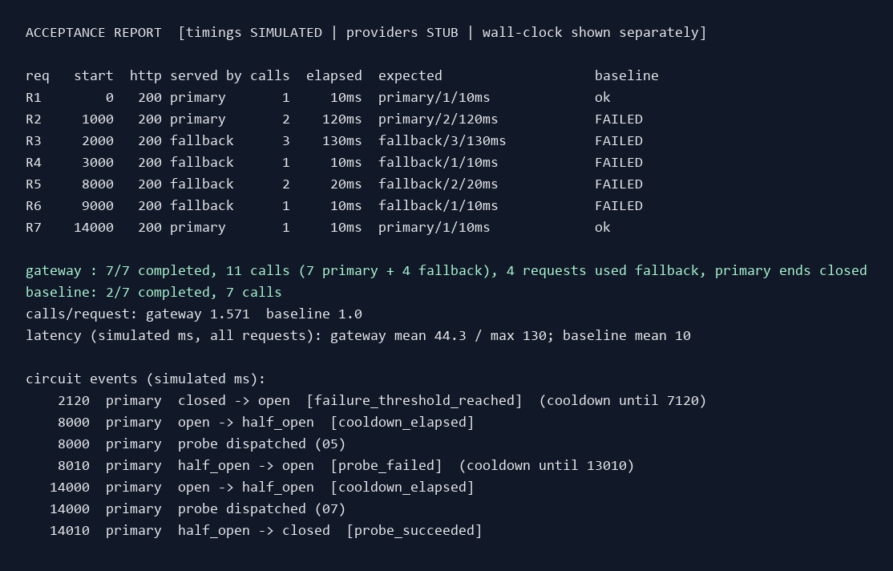
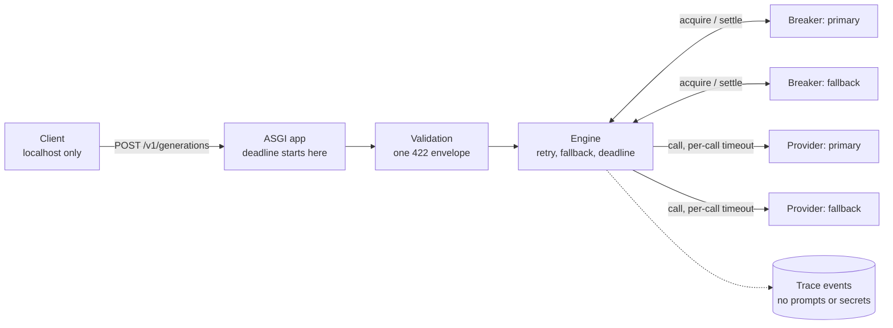

# Self-Healing LLM Gateway (MVP)

[](https://github.com/RyanJBush/self-healing-llm-gateway/actions/workflows/ci.yml)
[](LICENSE)

Local, non-streaming `POST /v1/generations` with two ordered providers (`primary`, then
`fallback`), gateway-owned retries, a total deadline, and per-provider circuit breakers.
One process, one worker, localhost only. **No authentication: do not expose it.**

**No exactly-once guarantee.** `request_id` only correlates trace events. A timeout leaves
the provider outcome uncertain; a retry or fallback after one can duplicate work or billing.



Run the complete demo with `python -m gateway.acceptance`. It shows primary success,
a retry, fallback while the circuit is open, a failed recovery probe, and recovery.
Providers are deterministic stubs and the reported request timings are simulated.

[Demo output](evidence/acceptance-report.txt) · [Machine-readable report](evidence/acceptance-report.json) · [Verification](evidence/verification.md) · [Portfolio case study](docs/portfolio.md)

Read next: [DECISIONS.md](DECISIONS.md) (assumptions and reconciliation log),
[openapi.yaml](openapi.yaml) (the contract), [docs/architecture.md](docs/architecture.md)
(diagrams).

## Architecture



Request-level and circuit-level diagrams are in [docs/architecture.md](docs/architecture.md).
The diagrams are written in Mermaid and render directly on GitHub.

## Failure policy

| Event | Action | Counts toward the circuit |
|---|---|---|
| Connection failure, timeout, upstream 408, 429, any 5xx | Retry primary once (after `max(100 ms, valid Retry-After)`), then fallback | Yes |
| Any other 4xx (including 400, 401, 403) | Stop: HTTP 502, one call, no retry, no fallback | No |
| Malformed successful response (or 1xx/3xx) | Stop: HTTP 502, no retry, no fallback | No |
| Client disconnect | Cancel the in-flight call, make no later call, write no response | No (a cancelled probe re-opens the circuit) |
| Unexpected exception | HTTP 500, no retry; log has exception type and frames only | No |
| Retry wait would not fit before the deadline | Skip the retry, consider fallback immediately | n/a |
| Retry wait that stalls | Cancelled at the absolute deadline: HTTP 504 | n/a |
| Open circuit, or half-open probe in flight | Skip that provider; no attempt used | n/a |
| Deadline reached (2,000 ms from handler entry) | Nothing more is dispatched: HTTP 504 | n/a |
| Failed fallback | Request ends (503, or 504 if the deadline passed), even with attempt capacity left | Yes |

Limits: 3 calls (primary at most 2, fallback at most 1), per-call timeout `min(500 ms,
remaining)`, never return from fallback to primary. Circuit: opens after 2 consecutive
qualifying failures, 5,000 ms cooldown from the opening failure, one probe at a time. A probe
success closes it; a qualifying probe failure re-opens it and restarts the cooldown; a
cancelled or non-qualifying probe releases the slot and re-opens it with a fresh cooldown.

## Verified comparison (deterministic stubs, simulated clock)

Seven fixed requests, every failure an upstream 503, every completed call exactly 10
simulated ms. Gateway versus a direct-primary baseline (one primary call per request, no
retry, no fallback, no circuit). Generated by `python -m gateway.acceptance`; 31/31
assertions pass.

| Request | Start (ms) | Gateway outcome | Gateway calls | Gateway latency (ms) | Baseline |
|---|---:|---|---:|---:|---|
| R1 | 0 | primary | 1 | 10 | completed |
| R2 | 1,000 | primary after retry | 2 | 120 | failed |
| R3 | 2,000 | fallback (circuit opens at 2,120) | 3 | 130 | failed |
| R4 | 3,000 | fallback (primary skipped) | 1 | 10 | failed |
| R5 | 8,000 | fallback (probe fails, re-open until 13,010) | 2 | 20 | failed |
| R6 | 9,000 | fallback (primary skipped) | 1 | 10 | failed |
| R7 | 14,000 | primary (probe succeeds, closes) | 1 | 10 | completed |

| | Completed | Provider calls | Calls per request | Mean latency (simulated) |
|---|---:|---:|---:|---:|
| Gateway | 7 / 7 | 11 (7 primary + 4 fallback) | 1.57 | 44.3 ms (max 130) |
| Direct primary | 2 / 7 | 7 | 1.00 | 10 ms |

What this shows: with the same failures, the gateway completes 5 more requests at the cost
of 4 more provider calls. What it does not show: real provider behaviour, real latency, or
real cost. All timings are **simulated**; providers are **stubs**.

## Limitations

**Pending (not verified; nothing here should be read as passing):**

- **GitHub CI: pending.** The workflow is written and parses as YAML; it has not been run.
- **Linux and macOS: pending.** Everything was run on Windows 11 only.
- **Python 3.11: pending.** Not installed on the test machine (3.12, 3.13 and 3.14 were run on Windows).
- **Real LLM provider: pending.** Stubs only. The local HTTP integration tests use a
  controllable local server; they are not evidence of real-model integration.
- **Load behaviour: pending.** Concurrency was tested with up to 5 simultaneous requests on
  one event loop.

**Inherent limits:**

- A timeout or disconnect does not prove the remote work stopped. Retries and fallbacks
  after one can duplicate work or billing. Tests assert only what a local server can observe.
- Circuit state is in memory, per process; it resets on restart and is not shared across
  workers.
- No authentication, TLS, rate limiting, or streaming.
- Real-clock tests use wide timing margins because Windows timers are coarse (about 15 ms).

## Run

Clone this repository, open a terminal in its folder, and use Python 3.11+.

```bash
python -m venv .venv
# Windows PowerShell: .venv\Scripts\Activate.ps1
# Linux/macOS: source .venv/bin/activate
python -m pip install -e ".[test]"   # uvicorn + pytest, httpx, pyyaml, jsonschema
python -m gateway --port 8000        # binds 127.0.0.1 only; refuses other hosts
```

```bash
curl -s localhost:8000/v1/generations -H 'content-type: application/json' \
  -d '{"request_id":"123e4567-e89b-42d3-a456-426614174000","input":"hello","route":"standard"}'
```

Failure scenarios come from trusted config only. Point `GATEWAY_STUB_SCENARIO` at a JSON file:

```json
{"primary":  [{"kind": "http", "status": 429, "retry_after": "1"}, {"kind": "ok"}],
 "fallback": [{"kind": "ok"}]}
```

Step kinds: `ok`, `http` (`status`, optional `retry_after`), `connection_error`, `hang`,
`malformed` (`status`, `body`), `crash`; optional `delay_ms`. Call n runs step n; the last
step repeats.

## Verify

```bash
python -m pytest -q                                      # everything (about 12 s)
python -m gateway.acceptance --json acceptance.json      # R1..R7 report; exit 1 on any failed assertion
python scripts/mutations.py --json mutations.json        # 36 hand-written mutants
```

Most tests run on `gateway.simclock.SimulatedLoop` (a simulated monotonic clock), so the
real 2000 / 500 / 100 ms policy is checked exactly. `tests/test_live_server.py` (real
uvicorn) and `tests/test_http_integration.py` (real HTTP provider against a local server)
use the real clock. CI: `.github/workflows/ci.yml` (tests on Ubuntu and Windows for Python
3.11-3.13, then the acceptance report and a mutation job). The first CI run exposed an
early-wakeup retry bug on Windows/Python 3.11; v0.2.2 fixes it without weakening the
minimum-delay assertion. See [the correction](evidence/verification.md#publication-timing-correction-v022).

### What the mutation result does and does not show

`scripts/mutations.py` applies 36 hand-written breakages and expects the suite to fail. All 36
do make it fail. That is **not 36 independent behavioural protections**:

- one mutant (`probe-release-keeps-slot`) is **behaviourally equivalent**; it is detected only
  by an assertion on a private field (`_probe_in_flight`), so it is marked `KILLED*`;
- several mutants are caught by the same aggregate test (the acceptance report), so the
  count of distinct first-failing tests is lower (19 in the latest run; the script prints it);
- `fallback-retry-allowed` needs two redundant guards removed together, and `probe-may-retry`
  is observable only with a non-default zero cooldown.

The mutants are a spot check on the tests, not proof of correctness.

## Layout

| File | Role |
|---|---|
| `gateway/validation.py` | Request parsing; the one 422 envelope |
| `gateway/engine.py` | Retry, fallback, deadline, classification, `Retry-After`, trace events |
| `gateway/breaker.py` | Circuit breaker: 2 failures, 5 s cooldown, single probe, generations, lock |
| `gateway/providers.py` | `Provider` interface, deterministic stubs |
| `gateway/scenarios.py` | Scenario-keyed stubs for the R1..R7 sequence |
| `gateway/http_provider.py` | Real HTTP provider (httpx, no retries) |
| `gateway/app.py` | Pure ASGI handler: body read, disconnect cancellation, last-resort 500 |
| `gateway/safelog.py` | Logging helpers that never print exception text |
| `gateway/simclock.py`, `simclient.py` | Simulated clock; in-process ASGI client |
| `gateway/acceptance.py` | Sequence, baseline, independent cases, terminal + JSON report |
| `scripts/mutations.py` | Mutation check |

## Trace events

One JSON object per line on logger `gateway.events`. Every event has `event`, `request_id`,
`attempt` (dispatched calls only; `null` for skips), `provider`, `model`, `elapsed_ms`,
`outcome`, `reason`. Events: `attempt.start`, `attempt.end`, `provider.skipped`,
`retry.wait`, `retry.wait_cut_off`, `retry.skipped`, `breaker.transition`,
`request.finished`, `request.cancelled`. They never contain prompts, outputs, credentials,
authorization headers, or upstream bodies. Error logs for unexpected exceptions carry the
request ID, exception type and call-site frames only, never exception text.

## License

[MIT](LICENSE). Copyright 2026 Ryan J. Bush.
