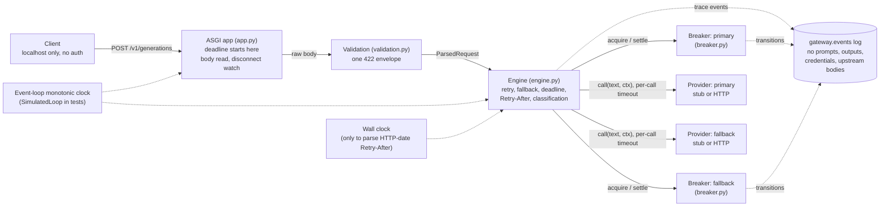
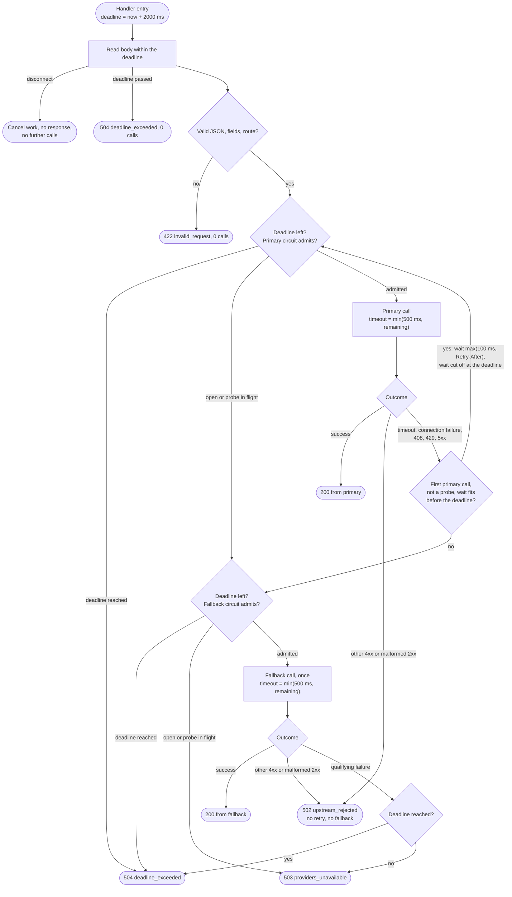
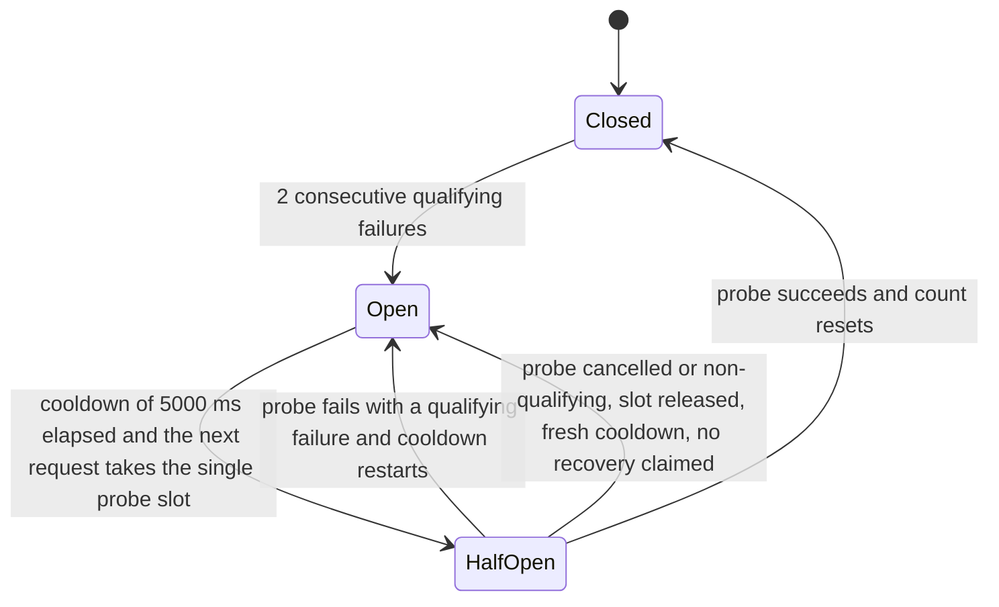

# Architecture

Three views: the parts, one request's decisions, and one provider's circuit.
Source of truth for behaviour is `openapi.yaml`, `DECISIONS.md`, and the tests.

## 1. Components

## 2. One request

Never returns from fallback to primary. At most 3 calls (primary 2, fallback 1). A failed
fallback ends the request. An unexpected exception anywhere is a sanitized 500 and is never
retried.

## 3. Circuit breaker (one per provider, in memory)

Qualifying failure: connection failure, timeout, 408, 429, 5xx. Other 4xx and malformed
successful responses neither increment nor reset the count. A success resets it. Completions
from calls admitted under an older generation are ignored.
